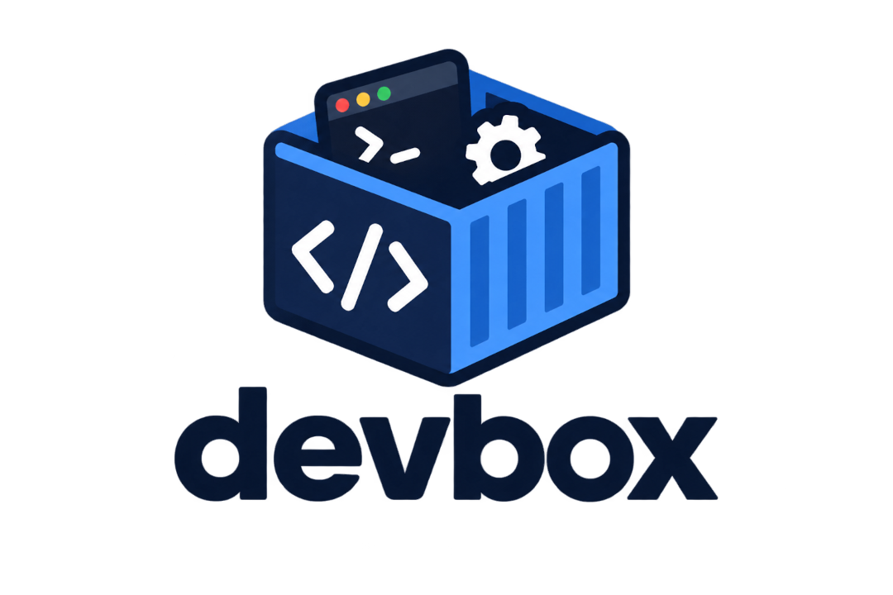

# devbox

One rootless-Podman devcontainer shared by all local projects. Debian slim, Claude Code,
Node LTS, gh. Claude's memory, plugins, skills and agents live in named volumes and survive rebuilds.
Secrets are sops+age files on the host, see Secrets.

## Why?

Agents are great for coding, but my laptop holds my digital life and it would be unwise
to hand over the keys to the castle. I got tired of spinning up a different devcontainer
for each project I'm working on, so this brings us here.

I'm sure there's some other project out there that deals with this better, but:

- I don't want to spend hours researching.
- This covers my exact needs right now. So this brings us here again. 😀

## Setup (once)

1. Install Podman and the VS Code Dev Containers extension.
2. In VS Code settings set `dev.containers.dockerPath` to `podman`.
3. Create the projects folder and put or clone your projects in it:
   `mkdir -p ~/src/projects`. This is the only part of `~/src` the container can see.
   To use another subdirectory, edit `workspaceMount` in `.devcontainer/devcontainer.json`.
4. Check `id -u` and `id -g`. If either is not 1000, change `--userns=keep-id:uid=...,gid=...`
   in `devcontainer.json` and `UID`/`GID` in the Dockerfile.
5. Open this folder in VS Code and run "Dev Containers: Reopen in Container".
6. In the container, File > Open Workspace from File > `/devbox/shared.code-workspace`.
   Add one `{ "name", "path": "/workspaces/<project>" }` entry per project.

## Volumes

| Volume | Mounted at | Holds |
|---|---|---|
| devbox-claude | ~/.claude | Claude config, memory, plugins, skills |
| devbox-agents | ~/.agents | agents |
| devbox-npm | ~/.npm | npm download cache |
| devbox-cache | ~/.cache | Playwright browsers and other caches |

`podman volume ls` lists them. A rebuild keeps them. `podman volume rm devbox-claude`
deletes that state for good.

## Secrets

Secrets live encrypted in a private git repo at `~/src/secrets` (read-only at `/secrets`).
On the host `devbox-secrets unlock` puts the box key on tmpfs; in the box
`with-secrets <project> <env> -- <cmd>` runs a command with the values in its environment.
Setup, workflow and limits: `docs/secrets.md`.

## Playwright (opt-in)

`bash /devbox/.devcontainer/install-playwright.sh /workspaces/<project>`. Run again after a
rebuild, since the system libraries live in the container layer.

## Limits

The container is capped at 8 GB and 6 CPUs (`runArgs`). Rootless limits need cgroup v2
delegation, supported by any modern systemd-based Linux distributions default (such as
Fedora 31+, Arch Linux, Debian 11+, Ubuntu 21.10+, and RHEL 9+) out of the box.
systemd 244 or newer is needed for non-root cgroup delegation If Podman complains, remove
the two flags.

See `docs/design.md` for the decisions behind this.
